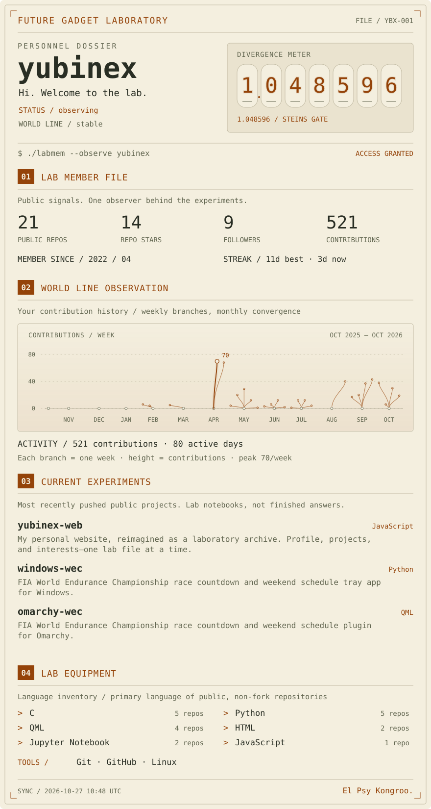
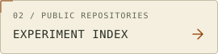
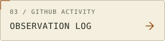

<!-- Generated by .github/scripts/static_profile.py from .github/profile-data.json. -->
<p align="center">
  <picture>
    <source media="(prefers-color-scheme: dark)" srcset="./assets/lab-dark.svg" />
    <source media="(prefers-color-scheme: light)" srcset="./assets/lab-light.svg" />
    
  </picture>
</p>

<p align="center">
  <a href="https://yubinex.github.io/yubinex-web/">
    <picture>
      <source media="(prefers-color-scheme: dark)" srcset="./assets/lab-nav-site-dark.svg" />
      <source media="(prefers-color-scheme: light)" srcset="./assets/lab-nav-site-light.svg" />
      
    </picture>
  </a>
  <a href="https://github.com/yubinex?tab=repositories">
    <picture>
      <source media="(prefers-color-scheme: dark)" srcset="./assets/lab-nav-repos-dark.svg" />
      <source media="(prefers-color-scheme: light)" srcset="./assets/lab-nav-repos-light.svg" />
      
    </picture>
  </a>
  <a href="https://github.com/yubinex?tab=overview">
    <picture>
      <source media="(prefers-color-scheme: dark)" srcset="./assets/lab-nav-activity-dark.svg" />
      <source media="(prefers-color-scheme: light)" srcset="./assets/lab-nav-activity-light.svg" />
      
    </picture>
  </a>
</p>

<details>
<summary><samp>[ FILE / TEXT MODE ] — open lab record &amp; project links</samp></summary>

## `FUTURE GADGET LABORATORY // TEXT ARCHIVE`

```text
OPERATOR      yubinex
STATUS        observing
WORLD LINE    stable
DIVERGENCE    1.048596 / decorative meter
```

### `01 / LAB MEMBER FILE`

```text
MEMBER SINCE  2022 / 04
PUBLIC REPOS  21
REPO STARS    14 / public, non-fork repositories
FOLLOWERS     9
```

### `02 / WORLD LINE OBSERVATION`

```text
CONTRIBUTIONS 521 / calendar snapshot
ACTIVE DAYS   80
BEST STREAK   11 days
NOW           3 days
PEAK WEEK     70 contributions
```
Read left to right. Each branch is one week of real GitHub contributions, and its
endpoint height follows the numbered contribution scale. Weeks converge into
monthly bundles, grouped by the first date in each calendar week. Zero-contribution
weeks have zero height. The brightest branch marks a peak week: **70 contributions**.
These are GitHub contribution-calendar counts, not commit-only counts: contributions
can also include pull requests, issues, and other GitHub activity.

| `MONTH / WEEK START` | `CONTRIBUTIONS` |
| :--- | ---: |
| `2025-10` | `0` |
| `2025-11` | `0` |
| `2025-12` | `0` |
| `2026-01` | `0` |
| `2026-02` | `10` |
| `2026-03` | `5` |
| `2026-04` | `138` |
| `2026-05` | `66` |
| `2026-06` | `23` |
| `2026-07` | `29` |
| `2026-08` | `40` |
| `2026-09` | `117` |
| `2026-10` | `93` |

### `03 / CURRENT EXPERIMENTS`

Most recently pushed public, non-fork projects (excluding profile repositories):

- [`yubinex-web`](https://github.com/yubinex/yubinex-web) — My personal website, reimagined as a laboratory archive. Profile, projects, and interests—one lab file at a time.
- [`windows-wec`](https://github.com/yubinex/windows-wec) — FIA World Endurance Championship race countdown and weekend schedule tray app for Windows.
- [`omarchy-wec`](https://github.com/yubinex/omarchy-wec) — FIA World Endurance Championship race countdown and weekend schedule plugin for Omarchy.

### `04 / LAB EQUIPMENT`

Top languages by number of public, non-fork repositories using each as their primary language. This is an inventory, not a proficiency ranking or a code-volume breakdown.

```text
LANGUAGE INVENTORY
C                        5 public repos
Python                   5 public repos
QML                      4 public repos
HTML                     2 public repos
Jupyter Notebook         2 public repos
JavaScript               1 public repos

TOOLS / ENVIRONMENT
Git · GitHub · Linux
```

<samp>SYNC / 2026-10-28 11:30 UTC</samp>

<samp>END OF RECORD / El Psy Kongroo.</samp>

</details>
